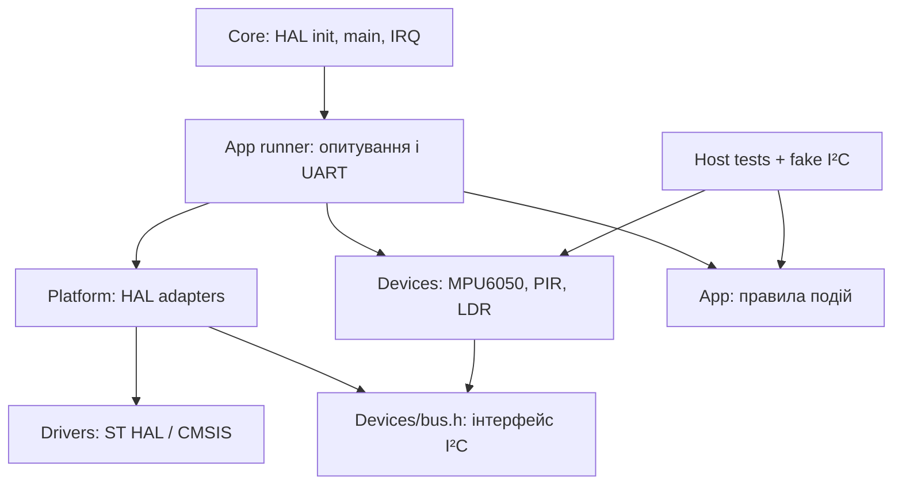

# Архітектура

## Компоненти

Чиста логіка App і драйвери Devices не включають HAL, Core або Platform. Файл інтеграції runner.c розміщено в Platform, оскільки він з'єднує переносні компоненти з платою. main.c викликає runner після ініціалізації.
Platform містить хендли, піни та доступ до периферії. Ініціалізація I²C, ADC, GPIO, UART виконується через HAL. Devices працює через callbacks mg_bus_t; адреса в драйвері завжди 7-бітна. Зсув адреси є відповідальністю адаптера. Error/timeout повертаються явно, застарілі покази не підміняють нові.
Для транзакцій I²C адаптер використовує регістри CR2/TXDR/RXDR/ISR/ICR, описані RM0490. У моделі Wokwi знайдено затримку оновлення TXIS: швидкий наступний запис TXDR зривав багатобайтову передачу. Перед першою передачею і після запису байта витримується 250 мкс за SysTick. RXDR читається без такої затримки, щоб не втрачати наступний байт. Читання регістру має дві фази зі STOP між встановленням вказівника та читанням. Цей обмін підтверджується захватами; роботу на фізичному MPU6050 окремо не перевірено. Вендорський HAL не змінюється.
Core зберігає периферійну ініціалізацію; прикладні виклики розміщено у USER CODE. Перед регенерацією CubeMX звіряти .ioc і Makefile, зберігати Platform/Devices/App.
Автоматична перевірка включень і збірка хостових тестів перевіряють розділення шарів.

## Виконання

Опитування кожні 20 мс через різницю unsigned tick, без HAL_Delay(1000). I²C має timeout 15 мс, ADC 2 мс. UART видає телеметрію раз на 500 мс і події при переході, а не на кожному циклі. Це polling, не жорсткі гарантії real-time. Затримка 100 мс потрібна лише перед стартовою самоперевіркою.
Команди UART: c — повторити читання ID і 14 байтів; n — помилкова адреса 0x69; r — скинути базові рівні і тривогу, повторити self-test.
При втраті IMU читаємо кожні 20 мс; повторну ініціалізацію виконуємо не частіше разу на секунду. Помилка реєструється один раз на перехід у несправність; відновлення окремою подією.
Тривога від механічної події фіксується до r або перезапуску. Присутність і світло є інформаційними подіями. Базовий рівень світла та прискорення визначається першим успішним виміром.
