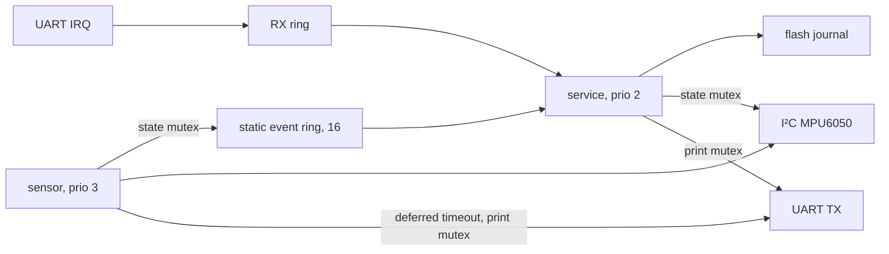

# Організація MuseGuard на FreeRTOS

Статус: робоча реалізація; виконання всіх вимог ЛР4 та її сценаріїв ще перевіряється. Функціональний код датчиків, детектора, команд і журналу походить з ЛР3. Контролер — STM32C031C6, 48 МГц; Cortex-M0+ використовує порт GCC/ARM_CM0, а не наведений у методичці приклад CM4F. Погодження цієї відмінності викладачем не встановлено. Ядро FreeRTOS-Kernel V10.6.2, commit `18ed8886fe3eed9dbe433a82cdc62ce5dc0315eb`, збережена ліцензія у `pilot/freertos/`.

| Задача | Пріоритет | Вивільнення | Стек |
|---|---:|---|---:|
| sensor | 3 | `xTaskDelayUntil`, 20 мс; пропущений період не наздоганяється пачкою | 384 слова = 1536 B |
| service | 2 | один крок, потім `vTaskDelay(1)` | 640 слів = 2560 B |
| idle | 0 | ядро | 128 слів = 512 B |

Sensor читає ADC, PIR і MPU6050, оновлює детектор і додає події до кільцевого буфера. Service виконує recovery, команди, один запис журналу за крок, вивід і heartbeat. Пріоритет sensor мотивований 20-мс періодом; поведінка з поточними блокуваннями ще не є доказом гарантії дедлайну.

Кільце подій має 16 записів `pending_t` по три `uint32_t` (192 B для payload і окремі індекси); воно статичне, не FreeRTOS queue. Модифікації спільного стану й кільця захищені state mutex. Service забирає одну подію і звільняє mutex на час реального flash append; власник flash та журналу тільки service. UART TX серіалізований окремим print mutex, UART RX надходить через ISR/ring. Service звільняє state mutex під час звичайного форматування і виводу. При I²C timeout знімаються flag/ISR/CR2 і повідомлення друкується після закінчення транзакції та виходу з state mutex; самі timeout та STOP очікуються всередині нього. Окремі буфери діагностики належать задачам і мають по два слоти; переповнення призводить до Error_Handler.

Динамічний heap_4 має 6144 B, включно з об'єктами задач, їхніми стеками, двома mutex і накладними витратами allocator; повторно додавати стеки до `.bss` не можна. FreeRTOS queues у цьому продукті не створюються; static event ring і UART RX ring обліковуються окремо. `configCHECK_FOR_STACK_OVERFLOW=2`, malloc-failure hook і assert викликають Error_Handler; результат навмисного переповнення ще потрібно перевірити. Tick=1000 Гц, таймерна задача вимкнена. SysTick обслуговує HAL tick і kernel tick після старту; це не окремий HAL timebase. CM0 використовує PRIMASK, а не припущення CM4F про BASEPRI/DWT.

Вивід RTOS містить поточний та мінімальний free heap і high-water marks трьох стеків. Вони є спостереженням лише виконаних шляхів. Вбудованого `vTaskGetRunTimeStats` або трасування всіх перемикань у поточній конфігурації немає; такі метрики не можна виводити з `busy_permille`, який сумує тривалість прикладних операцій і може рахувати перекриття. Потрібне незалежне вимірювання або окремий діагностичний варіант з перевіркою його впливу.
